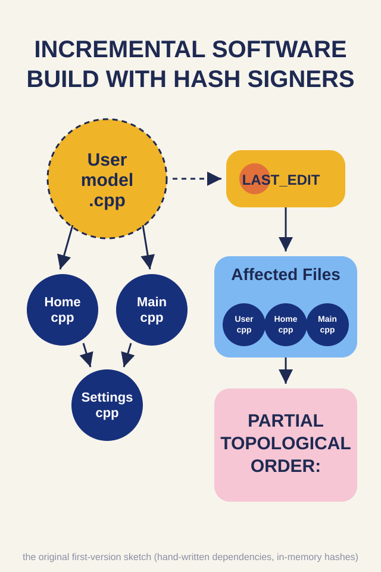
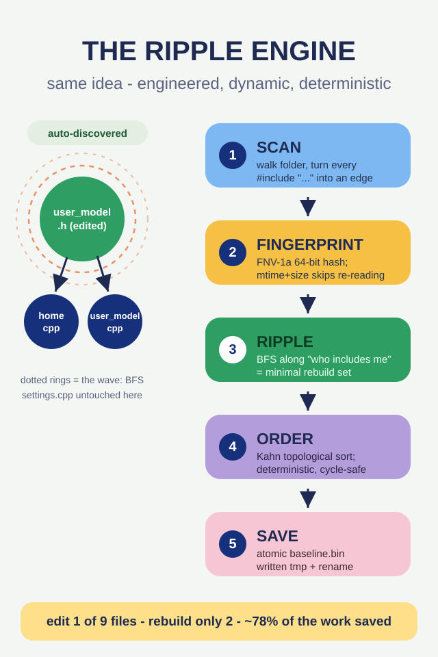
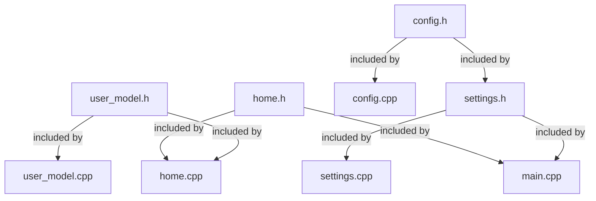

# GRAPH.md - The dependency graph, visually

Same content as [`ALGORITHM.md`](ALGORITHM.md), but drawn.
The demo project used everywhere below is
[`samples/demo_app`](../samples/demo_app).

<p align="center">
  
  &nbsp;
  
</p>

## The idea, then and now

The **first sketch** (left) already contained the three great ideas - a
dependency map, a change detector, and a topological build order. What the
RIPPLE engine (right) changed is *how* each idea is realized:

| idea | then | now |
|------|------|-----|
| dependency map | typed by hand, per project | derived from `#include` at every run |
| change detector | `LAST_EDIT` file timestamps | content hash (FNV-1a 64-bit) with mtime/size pre-filter |
| affected files | queue over hand-built edges | BFS over scanned edges |
| build order | partial, unordered ties | deterministic Kahn ordering + cycle warning |

The two SVGs above are versioned next to this document, so the comparison
lives in the repo itself.

## The project as Mermaid



**Edge reading rule**: `a --> b` means *b `#include`s a* => *if a changes, b may
need a rebuild*. This direction is what `ripple status` uses.

## ASCII form (same graph)

```
  config.h  --> settings.h --> main.cpp   (two-hop transitive chain)
  config.h  --> config.cpp
  config.h  --> settings.cpp
  settings.h --> settings.cpp
  home.h    --> home.cpp
  home.h    --> main.cpp
  user_model.h --> home.cpp
  user_model.h --> user_model.cpp
```

The long chain: editing `config.h` reaches both `settings.h` (direct) **and**
`main.cpp` (transitive, through `settings.h`) - that is BFS at work.

## What the tool prints

`ripple what-if samples/demo_app user_model.h`:

```
what-if: changing 'user_model.h' requires rebuilding 3 file(s)
order: user_model.h -> home.cpp -> user_model.cpp
user_model.h  <= changed
|-- home.cpp *affected*
`-- user_model.cpp *affected*
```

Note `main.cpp` is *not* on this list: `main.cpp` includes `home.h`, not
`user_model.h`. The graph is honest instead of paranoid.

`ripple what-if samples/demo_app config.h` - BFS depth 2 - and the tree
renderer draws it nested:

```
config.h  <= changed
|--  config.cpp *affected*
|--  settings.cpp *affected*
`--  settings.h *affected*
     |--  main.cpp *affected*
     `--  settings.cpp (shared node - shown above)
```

* Shared nodes print `(shared node - shown above)` instead of a duplicate
  subtree - bounded rendering on DAGs.
* If two files ever include each other, an explicit cycle warning appears
  and the offending set is listed under `[!] cyclic` in `status` output.

## How BFS walks the graph, step by step

Input: `changed = [user_model.h]`

```
frontier = [user_model.h]                      affected = {user_model.h}

step 1: pop user_model.h
        dependents = [user_model.cpp, home.cpp]
        both unseen -> add                      affected = {user_model.h,
                                                             user_model.cpp,
                                                             home.cpp}
        frontier = [home.cpp, user_model.cpp]

step 2: pop home.cpp
        dependents = []  (nothing includes home.cpp)
step 3: pop user_model.cpp
        dependents = []
frontier empty -> stop
```

Result: `{user_model.h, user_model.cpp, home.cpp}` - exactly what the CLI
prints.

## How Kahn orders those 3 files

Edges inside the affected set: `user_model.h -> user_model.cpp` and
`user_model.h -> home.cpp`.

```
indegree before:   user_model.h = 0   user_model.cpp = 1   home.cpp = 1

ready (0-indegree, min-name first) = [user_model.h]

emit user_model.h  ->  both dependents drop to 0  ->  push home.cpp,
                                                      user_model.cpp

emit home.cpp (alphabetical tie-break)
emit user_model.cpp

sequence = [user_model.h, home.cpp, user_model.cpp]
```

Deterministic: alphabetical tie-breaking. Run it twice, snapshot diff empty.
For pipelines and IDEs this is the property you actually want from "just
give me an order".

## Terminal UX

The interactive menu (`ripple` with no command) re-runs this machinery under
arrow keys:

* **Up/Down (or j/k)** - move the selection through the files
* **Enter** - commit the selection
* **1..5** - scan / status / what-if / baseline / how it works
* **q / Esc** - leave

Colors: nodes on the affected set print in red with a `*affected*` marker,
the root keeps a `<= changed` badge, hints print dim. Every frame is
re-rendered from the model, so the screen always reflects reality.

## Embedding the graph

```text
$ ripple scan samples/demo_app
root: samples/demo_app
files discovered: 9
edges: 9

dependency edges (a -> who depends on a):
config.h                 -> config.cpp settings.cpp settings.h
home.h                   -> home.cpp main.cpp
settings.h               -> main.cpp settings.cpp
user_model.h             -> home.cpp user_model.cpp
```

That block is the literal graph - copy it into your README, test fixture,
or meeting notes. Nothing about the demo is special: point `ripple scan` at
any real codebase and you get its shape in one shot.
